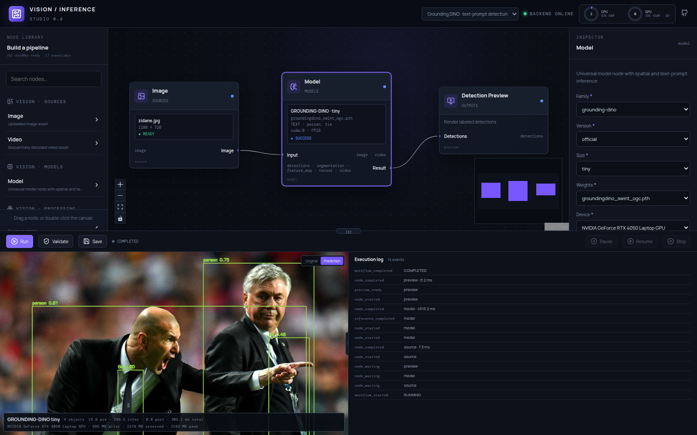
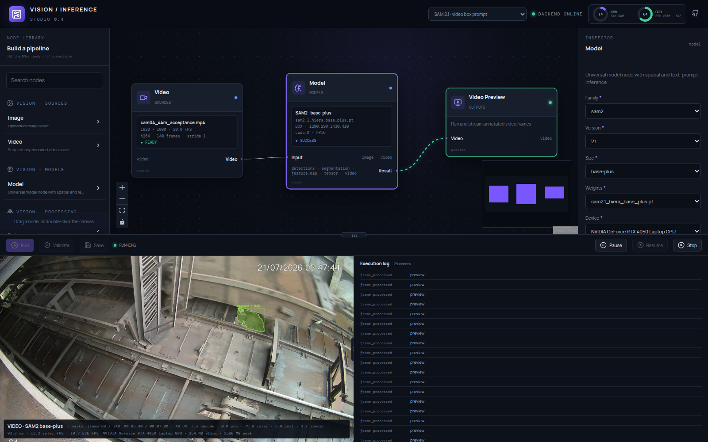

# Vision Inference Studio

A local, node-based computer-vision inference workbench. You build a typed workflow graph on a React Flow canvas, upload images, videos and model weights, then run image or frame-by-frame video inference on your own GPU. Results stream back live over WebSocket. Vision Inference Studio runs as a desktop app (Electron) or as a FastAPI backend with a browser UI.

Current version: **0.6.0**. Linux x86_64 packages for every release are attached to the [GitHub releases](../../releases).



---

## Contents

1. [What it does](#what-it-does)
2. [Releases and packages](#releases-and-packages)
3. [Install the desktop app (.deb)](#install-the-desktop-app-deb)
4. [Install the portable bundle (.tar.gz / .zip)](#install-the-portable-bundle-targz--zip)
5. [Development setup](#development-setup)
6. [Using the studio](#using-the-studio)
7. [Feature runtime: change detection with DINOv3 and RF-DETR](#feature-runtime-change-detection-with-dinov3-and-rf-detr)
8. [Public Hub, benchmarks, experiments and recipes (v0.6)](#public-hub-benchmarks-experiments-and-recipes-v06)
9. [Supported models](#supported-models)
10. [Node reference](#node-reference)
11. [Architecture](#architecture)
12. [Configuration reference](#configuration-reference)
13. [HTTP and WebSocket API](#http-and-websocket-api)
14. [Building the packages](#building-the-packages)
15. [Testing](#testing)
16. [Security model](#security-model)
17. [Repository layout](#repository-layout)
18. [Known limitations](#known-limitations)

---

## What it does

Vision Inference Studio is an **inference experimentation environment**. It runs the same model and fixed images through different preprocessing, inference and postprocessing settings. It measures each result, shows the visual output side by side, and lets you promote the configuration that works. It is not a training tool and not a production annotation queue.

```text
model + preprocessing + inference + postprocessing
                         │
                  immutable benchmark
                         │
             Recipe A ───┼─── Recipe B ─── Recipe C
                         │
            typed output + latency / VRAM / evaluation
                         │
                    compare visually
                         │
                  promote pinned recipe ──► Auto Annotation Studio
```

**Main capabilities:**

- **Visual workflow graph:** typed ports, a metadata-driven inspector, validation before every run, and live node status (waiting, loading, running, success or error).
- **Image and video inference:** sequential video decoding, configurable frame stride, warm-up frames, and Pause / Resume / Stop at frame boundaries. Latency distributions are recorded for every stage.
- **Model families:** YOLO, RF-DETR, DINOv3, generic ONNX, official Grounding DINO, SAM, SAM 2/2.1 and SAM 3.
- **Feature runtime:** DINOv3, RF-DETR v2.2 and RF-DETR Architecture B feature maps, with difference, normalisation, activation-XOR and Mahalanobis change heatmaps.
- **chaiNNer node import:** about 160 image-processing nodes from a local chaiNNer source tree, run in memory with lazy sequences.
- **Public Hub (v0.6):** discover and import datasets and models from Hugging Face, Roboflow Universe and Kaggle, inspect them, freeze benchmarks, run multi-workflow experiments, and promote immutable recipes.
- **GPU-aware runtime:**
  - a model cache keyed by an immutable identity, so each checkpoint loads once;
  - serialised inference;
  - CUDA-synchronised timing;
  - live CPU, RAM, GPU and VRAM metrics in the header.

---

## Releases and packages

Each version is a git tag with a GitHub release. Model weights are **not** included in any package; you upload them in the app.

| Tag | Highlights | Assets |
|---|---|---|
| **v0.6.0** | Public Resource Hub (Hugging Face / Roboflow / Kaggle), API Keys page, durable downloads, dataset/model inspection, immutable benchmarks, experiments, comparisons, recipe promotion. Packaging fix: `requirements-public-hub.txt` is now shipped and hashed. | `.deb`, portable `.zip` |
| **v0.5.0** | Immutable `ModelKey` and per-call requests, `ExecutionScope` cleanup, explicit runtime values, lazy chaiNNer streams, DINOv3 spatial features, `FeatureStore`, RF-DETR v2.2 and Architecture B feature providers, Activation XOR, Mahalanobis difference, geometry store | `.deb`, portable `.zip` |
| **v0.4.0** | SAM, SAM 2/2.1, SAM 3, official Grounding DINO, chaiNNer node import, self-contained desktop build with bundled Python 3.12.15 | `.deb`, portable `.tar.gz` |
| **v0.3.0** | Electron desktop app with a private runtime installer, portable install/uninstall scripts, resizable live preview | `.deb`, portable `.tar.gz` |
| **v0.2.0** | Real video inference with benchmarks; first Linux packages | `.deb`, portable `.tar.gz` |
| **v0.1.0** | Node canvas, typed workflow validation and execution, real YOLO / RF-DETR / DINOv3 / ONNX image inference | source only |

Every asset has a `SHA256SUMS` file in the same release. Verify downloads with `sha256sum -c SHA256SUMS --ignore-missing`.

---

## Install the desktop app (.deb)

**Requirements:**
- 64-bit Linux with glibc 2.28+ (Ubuntu 20.04+ / Debian 11+)
- about 20 GB free disk and 16 GB RAM (recommended)
- optional: an NVIDIA driver 525+ for CUDA

```bash
sha256sum -c SHA256SUMS --ignore-missing
sudo apt install ./vision-inference-studio_0.6.0_amd64.deb
vision-inference-studio            # or launch it from the applications menu
```

The app ships its own Python 3.12.15, so no system Python is needed. On first launch, click **Install Runtime**. It creates a private virtual environment in `~/.local/share/vision-inference-studio/runtime/venv` and installs PyTorch (CUDA 12.1) plus the inference packages from prebuilt wheels. That is about a 4 GB download and about 10 GB on disk. Use **Runtime → Repair Runtime** or **Reinstall Runtime** in the menu if it ever breaks; **Runtime → Status** shows the current state, and **Help → Open Logs Folder** opens the logs.

**Where the desktop app keeps data:**

| Path | Contents |
|---|---|
| `/usr/lib/vision-inference-studio/` | Application (read-only) |
| `~/.local/share/vision-inference-studio/` | Runtime, weights, workflows, workspace, benchmarks, logs |
| `~/.config/vision-inference-studio/.env` | Optional secrets (`HF_TOKEN`, provider keys) |
| `~/.local/share/vision-inference-studio/logs/` | `backend.log`, `runtime-setup.log`, `electron.log` |

> **Launching from a VS Code terminal:** VS Code sets `ELECTRON_RUN_AS_NODE`, which stops Electron from opening a window. Run `env -u ELECTRON_RUN_AS_NODE vision-inference-studio` instead.

### Using an existing Python environment instead of the private runtime

If you already have a working environment (Python 3.10+ with the packages from `requirements-desktop.txt` and `requirements-public-hub.txt`), you can point the app at it and skip the runtime download.
1. Link the runtime folder to your environment:
   ```bash
   R=~/.local/share/vision-inference-studio/runtime
   mkdir -p "$R" && ln -sfn /path/to/your/venv "$R/venv"
   ```
2. Write `$R/runtime-version.json` with the installed version and the requirements hash:
   ```bash
   A=/usr/lib/vision-inference-studio/resources
   HASH=$(VIS_APP_ROOT=$A bash $A/packaging/linux/setup-runtime.sh --print-requirements-hash | tail -1)
   cat > "$R/runtime-version.json" <<EOF
   {"app_version": "0.6.0", "requirements_hash": "$HASH", "python_version": "3.12",
    "python_executable": "/path/to/your/venv/bin/python", "created_at": "$(date -Is)", "cuda": {"available": true}}
   EOF
   ```
3. Confirm the environment has everything:
   ```bash
   cd /usr/lib/vision-inference-studio/resources
   PYTHONPATH=backend "$R/venv/bin/python" -m inference_studio.runtime_check --json
   ```

The backend runs as `runtime/venv/bin/python -m uvicorn inference_studio.main:app` with `PYTHONPATH` set to the packaged backend, so the app itself does not need to be installed into your environment.

Clicking **Install / Repair Runtime** later is safe for your environment. The script sees a different interpreter, removes only the symlink, and builds a separate private runtime. Each app upgrade changes `app_version`, so after upgrading, update the metadata file again.

---

## Install the portable bundle (.tar.gz / .zip)

Both portable formats need no root access.

**v0.5.0 and later (`.zip`)** contain the unpacked app folder. Run it in place:

```bash
unzip vision-inference-studio-0.6.0-linux-x64.zip
"./Vision Inference Studio-linux-x64/vision-inference-studio"
```

**v0.2.0–v0.4.0 (`.tar.gz`)** contain an installer:

```bash
tar -xzf vision-inference-studio-0.4.0-linux-x64.tar.gz
cd vision-inference-studio-0.4.0-linux-x64 && ./install.sh     # installs under ~/.local, adds a menu entry
```

In the `.tar.gz` bundles, `uninstall.sh` removes the application. Either way, the first launch offers **Install Runtime**, exactly as the `.deb` does. Your data under `~/.local/share/vision-inference-studio/` is kept unless you delete it.

---

## Development setup

### Backend

Use Python 3.10+ (3.12 is tested) in one virtual environment:

```bash
python3.12 -m venv ~/venv
~/venv/bin/pip install -r requirements-dev.txt -r requirements-runtimes.txt -r requirements-public-hub.txt
# Prompt models (official Grounding DINO + CLIP tokenizer for SAM 3), built from pinned source commits:
~/venv/bin/pip install --no-deps --no-build-isolation -r requirements-prompt-models.txt
# chaiNNer Standard node dependencies:
~/venv/bin/pip install -r requirements-chainner-standard.txt

PYTHONPATH=backend ~/venv/bin/uvicorn inference_studio.main:app --host 0.0.0.0 --port 8000
```

- Install the PyTorch wheel that matches your NVIDIA driver. The lock file pins `torch==2.5.1+cu121`.
- `requirements.txt` holds the API/graph baseline. The heavy ML packages live in `requirements-runtimes.txt`, so graph development and unit tests don't need them.
- Interactive API docs: `http://localhost:8000/docs`.

### Frontend

The frontend needs Node 20+:

```bash
cd frontend
npm ci
npm run dev -- --host 0.0.0.0        # http://localhost:5173, proxies /api to :8000
npm run build                        # production bundle in frontend/dist
```

Override the API address with `VITE_API_URL`. If Node isn't installed on the host, build with Docker: `docker run --rm -v "$PWD/frontend:/app" -w /app node:22-alpine npm run build`. Docker leaves root-owned files in `frontend/dist` and `node_modules/.vite-temp`, so afterwards either `chown` them back or build with `vite build --configLoader native --outDir <dir>`.

### Secrets

Copy `.env.example` to `.env`; it is git-ignored. You can also use the **API Keys** page, which validates a credential before writing it atomically with mode `0600`. Secret values are never returned to the browser.

```bash
cp .env.example .env    # HF_TOKEN, ROBOFLOW_API_KEY, KAGGLE_API_TOKEN or KAGGLE_USERNAME/KAGGLE_KEY
```

`HF_TOKEN` is needed for the gated `facebook/sam3` checkpoint and for Grounding DINO's `bert-base-uncased` download on first load.

### chaiNNer nodes

Point the backend at a local chaiNNer source tree with `export VIS_CHAINNER_SRC_DIR=/path/to/chainner/src`. Development builds also detect a sibling `src/` folder. The import report is written to `workspace/reports/chainner-node-import.json`. Nodes whose optional dependencies (NCNN, TensorRT, some PyTorch restorations) are missing stay visible and show the exact import error.

### Docker

Docker runs the graph, API and UI:

```bash
docker compose up --build -d
# GPU inference image: docker build --build-arg INSTALL_RUNTIMES=1 -f backend/Dockerfile .
```

The NVIDIA container runtime and a CUDA-compatible PyTorch wheel depend on the host, so they are never assumed.

---

## Using the studio

1. Drag **Image** or **Video** from the Node Library (or double-click the canvas) and upload an asset.
2. Add the universal **Model** node. Choose family, then version, then size; dependent fields reset when a parent field changes.
3. Upload a compatible weight file. The browser only ever receives an opaque weight ID, never a server path.
4. Set device, precision and thresholds. The inspector shows only the controls a family uses (`controls` in `config/models.yaml`).
   - **Grounding DINO:** comma-separated text prompt, e.g. `skip car, truck, person`.
   - **SAM / SAM 2:** point (`x,y`) or box (`x1,y1,x2,y2`) prompt in source-image pixels.
   - **SAM 3:** a text prompt (all instances of each concept) or a point/box prompt (one object).
5. Connect a matching preview node: Detection, Segmentation, Feature, Heatmap, Tensor or Video.
6. Click **Validate**, then **Run**. Active edges animate, nodes show their state, and results stream into the **Live Output** dock.
7. Toggle **Original** / **Prediction**, and read the preprocess / inference / postprocess / total timings, object count, and GPU allocated / reserved / peak memory.
8. **Video:** set `frame_stride` (1 = every frame, 5 = frames 0, 5, 10, …), warm-up frames and an optional benchmark-frame limit. The model loads once and is reused for every frame. Pause / Resume / Stop act at frame boundaries.
9. Resize **Live Output** with its top grip and side divider; the size persists across restarts.

Example workflows are in `workflows/examples/`. Replace their placeholder asset and weight IDs with the IDs you get from uploads.



---

## Feature runtime: change detection with DINOv3 and RF-DETR

Feature nodes compare a **reference** image with a **current** image in a model's feature space. The output is a continuous change heatmap.

```text
Image (reference) ─► Feature Extract ─┐
                                      ├─► Feature Difference / Activation XOR / Mahalanobis ─► Heatmap Preview
Image (current)   ─► Feature Extract ─┘
```

**Feature providers:**

| Provider | Model | Input | Stage | Feature grid |
|---|---|---|---|---|
| `dinov3` | DINOv3 ViT (Transformers) | processor size | `last_hidden_state` | patch grid × C (CLS/register tokens removed) |
| `rfdetr-v2.2` | `RFDETRLargeDeprecated` | 560 × 560 | `fine_80` | 80 × 80 × 384 |
| `rfdetr-v2.2` | `RFDETRLargeDeprecated` | 560 × 560 | `coarse_20` | 20 × 20 × 384 |
| `rfdetr-arch-b` | `RFDETRSegLarge`, patch 12 | 504 × 504 | `backbone_42` | 42 × 42 × 256 |

**Comparison operations:**

| Node | Works with | Output |
|---|---|---|
| Feature Difference | any two compatible features | `raw` / `absolute` delta feature and an `l2` / `cosine` heatmap |
| Feature Normalize | any feature | new artifact, channel-wise L2 (or `none`) |
| RF-DETR Activation XOR | `rfdetr-v2.2` only | per-token fraction of channels whose activation (above the reference's 90th-percentile threshold) flipped. Continuous; no threshold is applied |
| Mahalanobis Feature Difference | `rfdetr-arch-b` only | squared Mahalanobis distance of `current − reference` under a frozen clear-scene geometry (μ [256], Cholesky [256,256]), solved in float64 without an explicit inverse. τ is stored but **never applied** |

**Rules the runtime enforces:**

- **Strict compatibility:** features are compared only when their signatures match exactly: provider, version, variant, stage, checkpoint SHA-256, input size, stride, preprocessing and shape. Otherwise the run fails with `FeatureSpaceMismatch` ("Cannot compare: …"), naming both feature spaces. Grids are never resized to fit.
- **Provider checks at validation:** the validator rejects XOR on non-v2.2 features and Mahalanobis on non-Architecture-B features before a run starts (`incompatible_feature_provider`).
- **One load per model:** the feature model cache key is family / version / variant / weight / device / precision. It contains no stage, threshold or reference/current role, so reference and current share one loaded model across stages.
- **One Architecture B forward:** each image gets a single backbone forward. Its `srcs/masks/poss` are kept, so a semantic branch reuses them without a second backbone pass.
- **Tensors stay on the backend:** they stay on their device in the `FeatureStore` (`feat_<uuid>` IDs, refcounted by planner consumer counts, released when a run ends). API and WebSocket payloads carry only IDs, shapes and statistics. Store limits come from `VIS_FEATURE_STORE_MAX_ENTRIES` / `_MAX_BYTES`, and a full store raises `FeatureStoreCapacityExceeded`; nothing is evicted silently.
- **Display-only interpolation:** heatmaps are interpolated only when rendered for display.

**Mahalanobis geometries** live in `VIS_GEOMETRIES_DIR`, outside the repo, and are selected by opaque ID (`geo_<name>`); clients never send file paths. To import one:

```bash
PYTHONPATH=backend python -m inference_studio.features.import_geometry \
  --id geo_archb_b2_frozen --weight-id <architecture-b weight id> \
  --mu mu_delta.npy --sigma sigma.npy \
  --corpus "<calibration corpus>" --method "<fitting method>" --tau-preset 589.3056640625
```

The source-of-truth RF-DETR code is vendored verbatim in `backend/inference_studio/features/extractors/vendor/`, with pinned SHA-256 prefixes checked by tests. The real-model acceptance report, including bit-exact parity with the original modules, is in [`docs/acceptance/rfdetr-feature-runtime/REPORT.md`](docs/acceptance/rfdetr-feature-runtime/REPORT.md).

---

## Public Hub, benchmarks, experiments and recipes (v0.6)

1. **API Keys:** configure Hugging Face, Roboflow or Kaggle credentials. Each one is validated before it is saved.
2. **Public Hub:** search datasets and models. Dataset cards show a lazy preview: a first-row sample for Hugging Face, an annotated sample for Roboflow, the thumbnail for Kaggle. Check the license and exact source identity, then choose **Download & register**.
3. **Downloads:** jobs are file-backed, survive a closed browser or a backend restart, and can be cancelled or retried. Completed dataset imports show sample thumbnails with dimensions and classes.
4. **Assets:** inspection status is one of `READY`, `PARTIAL`, `ADAPTER_REQUIRED`, `AMBIGUOUS`, `UNSUPPORTED` or `INVALID`.
5. **Benchmarks:** freeze an immutable random, stratified or manual subset of a registered dataset.
6. **Experiments:** pick one benchmark and two or more saved canvas workflows. Every variant runs through the normal execution engine on identical items. Operational metrics and side-by-side previews are persisted; accuracy metrics appear only when compatible ground truth exists.
7. **Recipes:** promote the winning variant to an immutable recipe that pins the workflow, benchmark, model/weight, hashes and runtime requirements. Auto Annotation Studio consumes only promoted recipes (`POST /api/v1/recipes/execute`).

**Provider coverage:**
- **Hugging Face:** datasets and models, at resolved revisions.
- **Roboflow Universe:** versioned datasets with format-aware export. No model artifacts are claimed.
- **Kaggle:** datasets, and model instances where the API exposes an `owner/model/framework/variation[/version]` identity.

Public datasets remain experiment assets. Moving one into production data is an explicit step in Auto Annotation.

The design decisions are recorded in [`docs/adr/`](docs/adr/): provider interface, server-side secrets, download ≠ executability, no remote code, immutable benchmarks, identical experiment inputs, versioned recipes, production sees promoted recipes only, and resource provenance.

---

## Supported models

| Family | Versions | Sizes | Result | Runtime |
|---|---|---|---|---|
| YOLO | v8, v11, v12 | n, s, m, l, x, custom | detections | Ultralytics |
| RF-DETR | v1 | nano, small, medium, base, large | detections | `rfdetr` |
| DINOv3 | official | vit-s, vit-b, vit-l | feature map | Transformers / PyTorch |
| Grounding DINO | official | tiny (Swin-T OGC), base (Swin-B) | text-prompt detections | IDEA-Research `groundingdino` |
| Segment Anything | v1 | vit-b, vit-l, vit-h | point / box segmentation | Transformers / PyTorch |
| Segment Anything 2 | 2.1, 2.0 | tiny, small, base-plus, large | point / box segmentation | Ultralytics |
| Segment Anything 3 | 3.0 | base | text-concept and point / box segmentation | Ultralytics |
| Generic ONNX | generic | custom | tensor | ONNX Runtime |

**Checkpoint notes:**

- **SAM (v1):** Hugging Face `facebook/sam-vit-*` safetensors or `.pth`, loaded data-only (`weights_only=True`).
- **Grounding DINO:** `groundingdino_swint_ogc.pth` (tiny) or `groundingdino_swinb_cogcoor.pth` (base). A checkpoint selected with the wrong size is rejected. Without compiled CUDA ops, it falls back to PyTorch deformable attention, which gives the same result more slowly.
- **SAM 2 / 2.1:**
  - accepts Meta `sam2.1_hiera_{tiny,small,base_plus,large}.pt` (or `sam2_hiera_*.pt`) and the Ultralytics `sam2.1_{t,s,b,l}.pt`;
  - the state dict loads strictly, so a mismatched version or size fails.
- **SAM 3:**
  - Checkpoint: `sam3.pt` from the gated `facebook/sam3` repository (3.45 GB).
  - Resolution: text prompts run at 1008 px; point/box prompts at 644 px, which keeps them within a 6 GB GPU.
  - Switching prompt mode reloads the model (about 10 s).
  - Loading needs about 6–7 GB of system RAM.
- **RF-DETR large:** the legacy `rf-detr-large.pth` is detected as `RFDETRLargeDeprecated`. It works, with an upstream warning. Use `rfdetr>=1.4,<1.7`; 1.11+ rejects that checkpoint.
- **Upload limit:** 5 GiB by default (`VIS_MAX_UPLOAD_BYTES`).

---

## Node reference

| Category | Node | Inputs → outputs |
|---|---|---|
| Sources | Image, Video | asset ID → `image` / `video` |
| Models | Model (universal) | `image` or `video` → registry-defined result |
| Processing | Resize, Crop, Threshold | `image` → `image` |
| Features | Feature Extract | `image` → `feature_map` (provider-dependent stages) |
| Features | Feature Normalize | `feature_map` → `feature_map` |
| Features | Feature Difference | reference + current → delta `feature_map` + `heatmap` |
| Features | RF-DETR Activation XOR | reference + current (v2.2) → `heatmap` |
| Features | Mahalanobis Feature Difference | reference + current (Architecture B) → `heatmap` |
| Outputs | Image, Detection, Segmentation, Feature, Heatmap, Tensor, Video Preview | typed result → rendered preview |
| chaiNNer | Registry-derived Standard / PyTorch / ONNX / NCNN / TensorRT / External nodes | native typed values, including lazy sequences |

The browser fetches node definitions from `GET /api/v1/nodes` and renders them generically. A field can declare `options_by` to change its options based on another field; for example, Feature Extract stages depend on the provider.

---

## Architecture

```text
React + Zustand ── node / edge / config JSON
      │
FastAPI ── asset / weight / geometry stores (opaque IDs only)
      │
WorkflowValidator ── types, ports, config, assets, weights, provider compatibility, DAG
      │
ExecutionPlan → ExecutionEngine + ExecutionScope → WebSocket events
      │              ├── ChainnerNodeExecutor → typed lazy StreamValue
      │              └── FeatureStore → normalize / difference / XOR / Mahalanobis / heatmap
      │
ModelManager (immutable-key cache, load lock, inference gate)
      ├── AdapterRegistry: YOLO · RF-DETR · DINOv3 · ONNX · Grounding DINO · SAM · SAM 2 · SAM 3
      └── FeatureExtractorRegistry: dinov3 · rfdetr-v2.2 · rfdetr-arch-b
      │
InferenceResult / FeatureArtifact → RendererRegistry (detection · segmentation · feature · tensor)

Video asset → VideoReader → frame scheduler → cached model handle → renderer → 10 rotating JPEG slots → latest-frame WebSocket
```

**Boundaries:**

- **Nodes** declare typed ports and config; the order of execution comes from the DAG, never from canvas position.
- **Adapters** are the only model-specific code (load, preprocess, infer, postprocess, unload, metadata). Their runtime imports are lazy, so a missing runtime disables only that family.
- **Execution:**
  - `ModelConfig` is split into an immutable `ModelKey` (identity) and a per-call `InferenceRequest` (thresholds, prompts), so a cached model never leaks one run's settings into another.
  - Every run owns an `ExecutionScope`, which closes streams, callbacks and feature artifacts in LIFO order on completion, error or cancel.
- **Renderers** turn standard results into previews; adapters never draw.
- **Frontend** knows nodes, ports, edges, config and status, never tensors or CUDA.

**Desktop app:**
- Electron starts the backend on a random loopback port with a per-session API token (`VIS_API_TOKEN`) and serves the built frontend.
- The backend stops when the app exits (`VIS_PARENT_PID`).

---

## Configuration reference

Variables are read from the environment and from `.env` (`VIS_ENV_FILE` points elsewhere). Variables already set in the environment take precedence.

| Variable | Default | Purpose |
|---|---|---|
| `VIS_PROJECT_ROOT` | repo root | Base for the default paths below |
| `VIS_DATA_DIR` | project root | Data root (desktop: `~/.local/share/vision-inference-studio`) |
| `VIS_CONFIG_DIR` | `config/` | Model registry and chaiNNer settings |
| `VIS_MODELS_FILE` | `config/models.yaml` | Model family registry |
| `VIS_WEIGHTS_DIR` | `weights/` | Uploaded weights |
| `VIS_WORKFLOWS_DIR` / `VIS_WORKSPACE_DIR` / `VIS_BENCHMARKS_DIR` / `VIS_REPORTS_DIR` | under the data dir | Saved workflows, assets/previews, benchmark JSON, reports |
| `VIS_GEOMETRIES_DIR` | `<data>/feature_geometries` | Frozen Mahalanobis geometries |
| `VIS_MAX_UPLOAD_BYTES` | `5368709120` | Upload size limit |
| `VIS_FEATURE_STORE_MAX_ENTRIES` / `VIS_FEATURE_STORE_MAX_BYTES` | built-in limits | Feature store capacity |
| `VIS_CHAINNER_SRC_DIR` | sibling `src/` | chaiNNer source tree |
| `VIS_RECIPE_INPUT_ROOTS` | unset | `os.pathsep`-separated roots allowed for server-to-server recipe execution |
| `VIS_API_TOKEN`, `VIS_DESKTOP_MODE`, `VIS_PARENT_PID` | set by the desktop app | Desktop session security and lifecycle |
| `HF_TOKEN` | — | Hugging Face (SAM 3, Grounding DINO BERT, Public Hub) |
| `ROBOFLOW_API_KEY` | — | Roboflow Universe |
| `KAGGLE_API_TOKEN` or `KAGGLE_USERNAME` + `KAGGLE_KEY` (`KAGGLE_CONFIG_DIR`) | — | Kaggle |
| `PUBLIC_HUB_CACHE` | `./workspace/public-hub` | Import cache (`PUBLIC_DATASET_CACHE` / `PUBLIC_MODEL_CACHE` split it) |
| `PUBLIC_HUB_MAX_CACHE_GB` / `_MAX_CONCURRENT_DOWNLOADS` / `_MAX_EXTRACT_GB` / `_MAX_FILE_GB` | `50` / `2` / `100` / `20` | Import limits |
| `VITE_API_URL` | `http://<host>:8000` | Frontend API address (build/dev time) |

---

## HTTP and WebSocket API

All routes are under `/api/v1` except `/health`. Interactive docs: `/docs`.

```text
GET  /health
GET  /nodes                        GET  /models          GET  /models/loaded
GET  /devices                      GET  /system/metrics  POST /models/load       POST /models/unload
GET  /weights                      POST /weights
POST /assets/image                 POST /assets/video
POST /workflows/validate           POST /workflows/run
GET  /workflows                    POST /workflows       GET  /workflows/{workflow_id}
POST /executions/{run_id}/pause    POST /executions/{run_id}/resume   POST /executions/{run_id}/stop
WS   /executions/{run_id}
GET  /features/stats               GET  /features/geometries
GET  /chainner/report              GET  /chainner/settings            PUT  /chainner/settings
GET  /benchmarks                   POST /benchmarks      GET  /benchmarks/{run_id}
GET  /runtime-benchmarks

GET  /public-hub/providers         POST /public-hub/providers/{provider}/test
GET  /public-hub/credentials       PUT  /public-hub/credentials/{provider}   DELETE /public-hub/credentials/{provider}
GET  /public-hub/datasets/search   GET  /public-hub/models/search    GET /public-hub/dataset-preview
GET  /public-hub/{datasets|models}/{provider}/{resource}
GET  /public-hub/downloads         POST /public-hub/downloads        GET /public-hub/downloads/events
GET  /public-hub/downloads/{id}    POST /public-hub/downloads/{id}/cancel   POST /public-hub/downloads/{id}/retry
GET  /assets/datasets              GET  /assets/datasets/{dataset_id}
GET  /assets/datasets/{dataset_id}/samples                GET /assets/datasets/{dataset_id}/samples/{item_id}
GET  /assets/models                GET  /assets/models/{model_artifact_id}
GET  /experiments                  POST /experiments                 GET /experiments/{id}
POST /experiments/{id}/start       POST /experiments/{id}/cancel     POST /experiments/{id}/promote
GET  /experiments/{id}/results     GET  /experiments/{id}/items/{item_id}
GET  /recipes                      GET  /recipes/{recipe_id}         POST /recipes/execute
```

Run events on the WebSocket carry a category in `type` and a lifecycle name in `event`. Video frames are delivered latest-first; lifecycle and control events are lossless.

---

## Building the packages

You need Node 20+ **with npm**; Electron Forge's preflight runs `npm --version`. You also need Python and `dpkg`/`fakeroot` for the `.deb`.

```bash
make desktop-make-linux
# = frontend build → desktop TypeScript build → stage resources → electron-forge make (linux/x64)
```

Outputs:
- `desktop/out/make/deb/x64/vision-inference-studio_<version>_amd64.deb`
- `desktop/out/make/zip/linux/x64/Vision Inference Studio-linux-x64-<version>.zip`

**What staging does** (`desktop/scripts/stage-resources.mjs`):
- copies the backend, config, frontend bundle, chaiNNer source, Linux packaging scripts and requirement files into `desktop/resources/`;
- downloads and checksum-verifies the relocatable CPython 3.12.15.

Prebuilt Grounding DINO / CLIP wheels go in `desktop/wheels/` (`desktop/scripts/build-wheels.sh`).

**Useful overrides:**
- `VIS_FRONTEND_DIST=<dir>`: use a frontend bundle built outside `frontend/dist`.
- `VIS_CHAINNER_SRC_DIR=<dir>`: chaiNNer source location.

**Adding a requirements file:** keep these lists in sync, or fresh runtime installs fail:
- `desktop/scripts/stage-resources.mjs` (staged);
- `desktop/forge.config.ts` (`extraResource`, packaged);
- `desktop/src/backend/RuntimeManager.ts` and both lists in `packaging/linux/setup-runtime.sh` (runtime hash and presence check).

**Release checklist:**
1. Bump the version in `pyproject.toml`, `backend/inference_studio/__init__.py`, `frontend/package.json` and `desktop/package.json`.
2. Build.
3. Check the package contents, e.g. `dpkg-deb -c <deb> | grep -E "requirements|dist/assets"`.
4. Scan for secrets.
5. Install and launch.
6. Tag `vX.Y.Z` and attach the `.deb`, `.zip` and `SHA256SUMS` to the GitHub release.

---

## Testing

```bash
PYTHONPATH=backend ~/venv/bin/pytest -q backend/tests            # unit + API suite
cd frontend && npm run build                                      # type-check + production build
```

**Real-model integration tests** are skipped unless their environment variables are set:

| Test | Variables |
|---|---|
| YOLO / RF-DETR image | `VIS_YOLO_WEIGHT`, `VIS_RFDETR_WEIGHT`, `VIS_TEST_IMAGE` |
| Video | `VIS_TEST_VIDEO` plus a weight variable |
| DINOv3 | `VIS_DINO_WEIGHTS`, `VIS_DINO_TEST_REFERENCE`, `VIS_DINO_TEST_CURRENT` |
| RF-DETR v2.2 features | `VIS_RFDETR_V22_WEIGHTS`, `VIS_FEATURE_TEST_IMAGE` |
| Architecture B features | `VIS_ARCHB_WEIGHTS`, `VIS_FEATURE_TEST_IMAGE`, optional `VIS_ARCHB_GEOMETRY` |

Set `VIS_TEST_DEVICE=cuda:0` when running the integration tests together. Ultralytics' CPU device selection otherwise hides the GPU from later tests in the same process.

**What the suite covers:**
- graph validation, planning and execution;
- immutable model identity and request isolation;
- inference serialisation and execution-scope cleanup;
- runtime values and lazy chaiNNer streams;
- the feature store, feature-space compatibility, all difference modes, XOR and Mahalanobis parity with the vendored references;
- the geometry store;
- Public Hub providers, credentials, downloads and archive safety;
- benchmarks, experiments and recipes.

---

## Security model

- Uploads stream into kind-specific stores under random opaque IDs. Filenames are reduced to their basename, client paths are never accepted, and resolved paths must stay inside their store.
- Uploading a file never loads a model; deserialization happens only on an explicit load or run. DINO and SAM state dicts load with `weights_only=True`, and geometries load data-only.
- There are no code, shell, dynamic-import, `eval` or `exec` nodes. Workflows serialize only JSON-safe config and IDs.
- Provider secrets stay on the backend. They never enter browser responses, workflows, download metadata or experiment records.
- Public archives are rejected on absolute/traversal paths, links, devices, oversized members or excessive expansion. Downloaded Python is never imported, and `trust_remote_code` is never enabled.
- Recipe execution against local paths is limited to `VIS_RECIPE_INPUT_ROOTS`.
- The desktop backend listens only on loopback and requires the per-session token.

Treat model files as trusted artifacts. Some runtimes (Ultralytics and PyTorch compatibility paths) unpickle checkpoints, so use weights from trusted sources and isolate the backend in production.

---

## Repository layout

```text
backend/inference_studio/
  adapters/        model families (YOLO, RF-DETR, DINOv3, ONNX, Grounding DINO, SAM, SAM 2, SAM 3)
  api/             HTTP + WebSocket routes
  assets/          asset records and storage
  chainner/        chaiNNer registry import, types, settings, execution
  features/        feature schema, store, ops, geometry store, visualization
    extractors/    dinov3, rfdetr_v22, rfdetr_arch_b, vendor/ (verbatim source-of-truth modules)
  graph/           schema, validator, planner, executor, persistence
  models/          manifest, registry, weight store, ModelManager
  nodes/           node definitions and runtime values
  public_hub/      providers, downloads, inspection, benchmarks, experiments, recipes
  renderers/  results/  runtime/  video/
backend/tests/     unit, API and integration tests
frontend/src/      React app (canvas, nodes, inspector, preview dock, pages)
desktop/           Electron main process, staging script, Forge config
packaging/         Linux runtime setup and portable install scripts
config/models.yaml model family registry
docs/              screenshots, ADRs, acceptance reports
workflows/examples/  example workflow graphs
release*/          per-release install guides and checksums (packages are on GitHub releases)
```

Runtime uploads, previews, saved workflows, virtual environments, weights, geometries and `.env` are git-ignored.

---

## Known limitations

- **Linux only:** packages are Linux x86_64; there are no Windows or macOS builds.
- **Weights are never packaged:** they must be uploaded. SAM 3 weights are gated by Meta's license.
- **Prompt models aren't in the desktop runtime:** they build from source, while the desktop runtime installs prebuilt wheels only. The desktop build bundles prebuilt Grounding DINO / CLIP wheels instead.
- **SAM family:** SAM, SAM 2 and SAM 3 segment each image or frame independently. There is no video tracking memory, no automatic mask generation, and no Grounding DINO → SAM box chaining yet.
- **Pause/cancel granularity:** checks happen between frames or nodes; a single third-party inference call can't be interrupted.
- **Generic ONNX:** assumes a single NCHW image input and exposes the first output.
- **DINOv3 and SAM (v1) metadata:** may need network access on first load unless cached. Real DINOv3 change metrics haven't been measured yet, because no checkpoint was available.
- **Mahalanobis geometries:** they are camera- and registration-specific. τ presets are metadata only; thresholding is a separate, explicit step.
- **chaiNNer:** type-expression-only visibility conditions are kept as metadata but always shown, because the browser doesn't evaluate the full Navi type language.
- **Out of scope:** remote execution, RTSP, training, annotation/export, scheduling and distributed workers.
